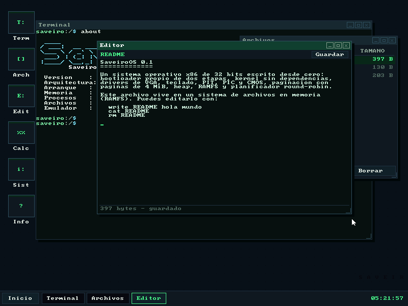
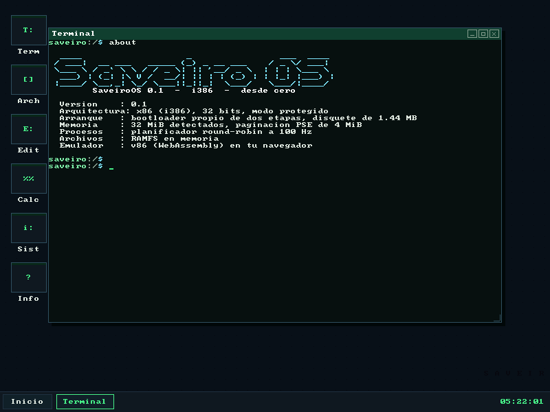
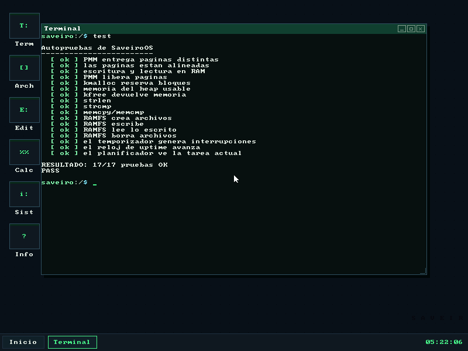

# SaveiroOS

Un sistema operativo para **x86 de 32 bits escrito desde cero** que arranca directamente en
un **escritorio gráfico de 800×600 con ratón y ventanas**: terminal, archivos, editor de
texto, calculadora, información del sistema y menú de inicio. Detrás hay bootloader propio,
kernel freestanding, paginación, heap, sistema de archivos en memoria, multitarea
round-robin y llamadas al sistema.

No usa GRUB, ni Linux, ni libc, ni ninguna biblioteca de terceros en el kernel.
El bootloader y el kernel caben en un disquete de 1,44 MB y también arrancan en el
navegador gracias a [v86](https://github.com/copy/v86).

```
  ____                   _                ___  ____
 / ___|  __ ___   _____ (_) _ __ ___    / _ \/ ___|
 \___ \ / _` \ \ / / _ \| || '__/ _ \  | | | \___ \
  ___) | (_| |\ V /  __/| || | | (_) | | |_| |___) |
 |____/ \__,_| \_/ \___||_||_|  \___/   \___/|____/
```

| El escritorio al arrancar: terminal, archivos y editor | La calculadora dentro de su ventana |
|---|---|
|  |  |

| La shell, ahora dentro de una ventana | Las 17 autopruebas del kernel |
|---|---|
|  |  |

---

## Demo en el navegador

```bash
make image     # compila bootloader + kernel y genera build/saveiro.img
make web       # instala v86 y copia los assets a web/assets
make serve     # http://localhost:8080
```

La máquina arranca sola y en unos segundos aparece el escritorio: no hay que escribir
ningún comando. Se usa con el ratón (arrastrar ventanas, botones de la barra de título,
menú **Inicio**, doble clic en los archivos) y con el teclado en la ventana que tenga el
foco.

---

## El escritorio

Es el producto: todo se hace desde la interfaz, sin consola de comandos obligatoria.

| Aplicación | Qué hace |
|---|---|
| **Terminal** | La shell del kernel dentro de una ventana: 42 filas, historial al hacer scroll, cursor de texto. |
| **Archivos** | Lista el RAMFS con nombre y tamaño; doble clic abre el archivo en el editor, `Borrar` lo elimina. |
| **Editor** | Carga un archivo del RAMFS, se escribe con el teclado, guarda con `Guardar`, `Ctrl+S` y al cerrar la ventana. |
| **Calculadora** | Suma, resta, multiplica y divide con teclado numérico y botones; `C` limpia. |
| **Sistema** | RAM libre, marcos de página, heap, tareas y tiempo encendido, en vivo. |
| **Acerca de** | Versión, autoría y atajos. |

Gestión de ventanas:

- **Arrastrar** por la barra de título, **redimensionar** desde la esquina inferior derecha,
  **minimizar** a la barra de tareas, **maximizar** (ocupa toda la pantalla menos la barra)
  y **cerrar**.
- La ventana con el foco se resalta; los clics y el teclado van a la de arriba.
- **Barra de tareas**: botón `Inicio`, un botón por ventana (con foco marcado) y reloj del
  CMOS.
- **Menú de inicio** con las seis aplicaciones, y **iconos en el escritorio** con doble clic.
- Atajos: `F1` terminal, `F2` archivos, `F3` calculadora, `ESC` cierra el menú.

Los iconos del escritorio (`Term`, `Arch`, `Edit`, `Calc`, `Sist`, `Info`) abren las mismas
aplicaciones con doble clic.

---

## Qué hay dentro

| Componente | Detalle |
|---|---|
| **Bootloader** | Dos etapas en ensamblador. El sector 0 (512 B) carga la etapa 2 desde disquete; la etapa 2 habilita A20, lee el mapa E820 del BIOS, carga el kernel y entra en modo protegido. |
| **Kernel** | 32 bits, `-ffreestanding`, sin libc. `printf`, `memcpy`, `strlen`, etc. propios. |
| **Segmentación** | GDT propia con segmentos planos de 4 GiB (código `0x08`, datos `0x10`). |
| **Interrupciones** | IDT de 256 entradas, stubs en ensamblador para 32 excepciones + 16 IRQ + `int 0x80`. PIC remapeado a `0x20/0x28`. |
| **Temporizador** | PIT a 100 Hz; `uptime` en segundos y *ticks* para el planificador y el reloj. |
| **Memoria** | Asignador de marcos con bitmap a partir del mapa E820, paginación por PSE con páginas de 4 MiB e identidad 0..128 MiB, heap *first-fit* de 4 MiB con `kmalloc`/`kfree`. |
| **Tareas** | Planificador round-robin apropiativo: el IRQ0 cambia de pila y reanuda otra tarea. El escritorio corre en su propia tarea, la shell en otra. |
| **Archivos** | RAMFS con 16 nodos y archivos de hasta 8 KiB (`ls`, `cat`, `write`, `rm`, y el editor gráfico). |
| **Drivers** | Tarjeta SVGA Bochs VBE con framebuffer lineal 800×600×8, teclado PS/2 (F1–F3, ESC, flechas), ratón PS/2 por IRQ12 (paquetes de 3 bytes, botones y rueda), CMOS/RTC y UART 16550 (COM1) como consola de depuración. |
| **Gráficos** | Fuente 8×8 copiada del BIOS, paleta fija de 24 colores, *back buffer* y volcado por rectángulos sucios. |
| **Escritorio** | Gestor de ventanas con composición por *back buffer*: pila de ventanas, foco, sombras, arrastre, redimensionado, minimizar/maximizar/cerrar, barra de tareas y menú de inicio. |
| **Syscalls** | Puerta `int 0x80`: `write`, `exit`, `getpid`, `uptime`. |
| **Shell** | 22 comandos, edición de línea, dentro de la ventana del terminal. |
| **Autopruebas** | `test` ejecuta 17 comprobaciones del kernel (memoria, heap, strings, RAMFS, IRQ, planificador). |

Tamaño del kernel: **~48 KiB** (unos 96 sectores del disquete).

---

## Cómo está hecho el escritorio

El driver SVGA programa el dispositivo Bochs VBE por los puertos `0x1CE/0x1CF`, mapea el
framebuffer lineal con páginas de 4 MiB y dibuja siempre sobre un *back buffer*; `gfx_flush`
copia los rectángulos sucios a la tarjeta. El gestor de ventanas (`kernel/gui/wm.c`) mantiene
una pila ordenada de ventanas, pinta de atrás hacia delante con recorte y repinta por zonas
dañadas, creciendo el área cuando una ventana tapa a otra para respetar la superposición.

El ratón llega por IRQ12 y tiene dos detalles propios de un driver real: los paquetes
acumulados en el controlador 8042 se drenan en cada interrupción leyendo el puerto `0x60`
mientras el bit 5 del puerto `0x64` marque datos auxiliares, y los clics se consumen como
eventos de flanco (`mouse_take_click`) para que un botón pulsado no se pierda entre dos
sondeos.

La consola es una interfaz (`console_t`) con dos implementaciones —texto VGA de 80×25 y la
ventana del terminal— y el teclado se puede redirigir con `input_set_source`, así que la
shell no cambia ni una línea según dónde escriba. Si la tarjeta no ofrece modo SVGA, el
kernel avisa y deja la consola de texto como respaldo.

---

## Cómo arranca

```
BIOS
 └─ sector 0 en 0x7C00       etapa 1: carga 4 sectores en 0x7E00
     └─ etapa 2 en 0x7E00    A20 + mapa E820 (0x5000) + carga el kernel
         └─ modo protegido, salto a 0x10000
             └─ kmain()      GDT · IDT · PIC · PIT · memoria · RAMFS · gui_boot()
                 └─ wm_task  escritorio 800x600 + terminal, shell y demás tareas
```

Distribución de la imagen (`build/saveiro.img`, 1 474 560 bytes):

| LBA | Contenido |
|---|---|
| 0 | sector de arranque con firma `0xAA55` |
| 1–4 | segunda etapa (2 KiB) |
| 5+ | kernel (el número de sectores se parchea en la etapa 2 al compilar) |

Mapa de memoria que usa el kernel:

| Dirección | Uso |
|---|---|
| `0x00005000` | mapa E820 que deja el BIOS |
| `0x00006000` | fuente 8×8 copiada de la BIOS por la etapa 2 |
| `0x00010000` | kernel (cargado y enlazado aquí) |
| `0x00090000` | pila del kernel (crece hacia abajo) |
| `0x000B8000` | memoria de texto VGA (solo como respaldo) |
| `0x00400000` | heap de 4 MiB |
| 1 MiB–32 MiB | marcos libres para el asignador y las pilas de tareas |
| heap (`0x00400000`) | *back buffer* del escritorio: 480 000 B reservados con `kmalloc` |
| `0xE0000000` | framebuffer lineal SVGA (BAR0 de la tarjeta, mapeado con páginas de 4 MiB) |

El detalle del diseño está en [`docs/arquitectura.md`](docs/arquitectura.md).

---

## Compilar

Requisitos: `gcc` con soporte `-m32`, binutils, `make`, `python3` y `node` (solo para la
demo web, las pruebas y las capturas).

```bash
make image    # boot + stage2 + kernel + imagen de disquete
make test     # arranca la imagen en v86 y conduce el escritorio por serie y ratón
make web      # prepara la demo web
make serve    # sirve la demo en 0.0.0.0:8080
make shots    # capturas de la shell y las autopruebas para la documentación
make shots-gui# capturas del escritorio: portada y calculadora
make clean
```

Ejemplo de salida de las pruebas:

```
SaveiroOS · prueba de arranque en v86

  ✓ el kernel arranca y muestra su banner
  ✓ el mapa E820 del BIOS se lee
  ✓ las autopruebas pasan sin fallos
  ✓ el asignador de páginas conoce 8192 marcos
  ✓ el RAMFS conserva sus archivos
  ✓ se puede leer un archivo completo
  ✓ el planificador ejecuta tareas nuevas
  ✓ int 0x80 despacha la llamada write()
  ✓ el RTC entrega fecha y hora
  ✓ RAMFS escribe y lee datos nuevos
  ✓ el sistema arranca directamente en modo 800x600x8
  ✓ el escritorio arranca con la ventana Terminal
  ✓ el menu de inicio abre la Calculadora
  ✓ las ventanas se arrastran por la barra de titulo
  ✓ el boton minimizar oculta la ventana
  ✓ la barra de tareas restaura la ventana
  ✓ el doble clic en un archivo abre el editor
  ✓ el editor guarda el texto en el RAMFS
  ✓ cerrar una ventana la quita del escritorio
  ✓ no hubo pánicos ni excepciones

PASS: 20 comprobaciones OK, 0 fallidas
```

`make test` no necesita navegador: usa v86 en Node, mueve el ratón por el adaptador PS/2,
hace clic en las ventanas, escribe con el teclado y comprueba el resultado por el puerto
serie.

---

## La shell

Sigue disponible dentro de la ventana del terminal (y por el puerto serie COM1):

| Comando | Qué hace |
|---|---|
| `help` | lista los comandos |
| `about` / `logo` | información del sistema y logotipo |
| `clear` | limpia la pantalla |
| `echo TEXTO` | imprime el texto |
| `mem` | RAM total/libre, páginas, heap y paginación |
| `ps` | tareas vivas, ticks y contador de trabajo |
| `spawn [n]` | crea n tareas de prueba |
| `kill ID` | termina una tarea |
| `ls` | archivos del RAMFS |
| `cat ARCHIVO` | muestra un archivo |
| `write ARCHIVO TEXTO` | añade texto a un archivo |
| `rm ARCHIVO` | borra un archivo |
| `date` | fecha y hora del CMOS |
| `uptime` / `ticks` | tiempo encendido y ticks del PIT |
| `syscall` | prueba `int 0x80` (`write`, `getpid`, `uptime`) |
| `test` | 17 autopruebas del kernel |
| `win` | lista las ventanas del escritorio |
| `mouseto X Y` | mueve el puntero (para pruebas automáticas) |
| `reboot` / `halt` | reinicia o detiene la máquina |

Una línea que empieza por `Ctrl-A` no se muestra: la usan las herramientas automáticas.

---

## Estructura del repositorio

```
boot/                 sector de arranque, etapa 2 y scripts de enlace
kernel/
  arch/i386/          entrada, GDT, IDT, stubs ISR, PIC, PIT, syscalls
  drivers/            SVGA, teclado PS/2, ratón PS/2, serie 16550, RTC
  gfx/gfx.c           framebuffer 800x600x8, fuente 8x8, paleta y back buffer
  gui/wm.c            gestor de ventanas, barra de tareas y menú de inicio
  gui/gui.c           consola del terminal y arranque del escritorio
  gui/apps.c          archivos, editor, calculadora, sistema y acerca de
  fs/ramfs.c          sistema de archivos en memoria
  lib/                string.h, printf, consola
  mm/                 PMM con bitmap, paginación PSE, heap
  sched/task.c        planificador y cambio de contexto
  shell/shell.c       shell interactiva y comandos
  kmain.c             secuencia de arranque del kernel
include/              cabeceras propias
web/                  interfaz con v86 (HTML/CSS/JS)
third_party/v86/      SeaBIOS y VGABIOS para el emulador (ver licencias)
tools/                mkimage.py, servidor estático, pruebas y capturas en v86
docs/arquitectura.md  diseño detallado
```

---

## Decisiones y límites

- **Sin modo usuario (anillo 3)**: las tareas corren en anillo 0. `int 0x80` existe y está
  accesible desde anillo 3, pero todavía no hay conmutación de pila a nivel de usuario.
- **Sin persistencia**: el RAMFS vive en memoria; al reiniciar se vuelve a sembrar.
- **Un solo núcleo**, sin APIC ni SMP.
- **Memoria virtual de identidad**: hay paginación real, pero sin *higher half* ni aislamiento
  entre tareas.
- El arranque asume geometría de disquete de 1,44 MB (18 sectores/pista, 2 cabezas).
- **8 bits por píxel**: la paleta es fija de 24 colores, suficiente para la interfaz pero
  sin degradados ni imágenes.
- **Sin cambio de tamaño de fuente ni ventanas superpuestas con transparencia**: el
  compositor es un *back buffer* a color plano.
- Máximo 8 ventanas a la vez y una sola tarea por ventana.

Siguientes pasos naturales: TSS + anillo 3, paginación de 4 KiB por proceso, un driver de
disco con MBR y un sistema de archivos persistente, y una pila de red para RTL8139.

---

## Terceros

- [v86](https://github.com/copy/v86) — emulador x86 en WebAssembly (MIT). Solo se usa en la demo web.
- **SeaBIOS** y **VGABIOS** — BIOS del emulador, en `third_party/v86/` con sus licencias LGPL.

El kernel, el bootloader, la shell, el escritorio y la interfaz son código propio de este
repositorio.
