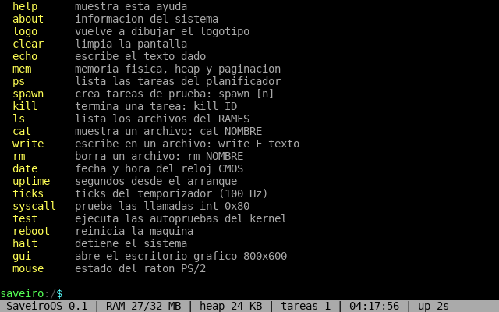

# SaveiroOS

Un sistema operativo para **x86 de 32 bits escrito desde cero**: sector de arranque propio,
kernel freestanding, paginación, heap, sistema de archivos en memoria, multitarea con
planificador round-robin, llamadas al sistema, una shell interactiva y un **escritorio
gráfico** en 800×600 con ratón y ventanas.

No usa GRUB, ni Linux, ni libc, ni ninguna biblioteca de terceros en el kernel.
El bootloader y el kernel caben en un disquete de 1,44 MB y también arrancan en el
navegador gracias a [v86](https://github.com/copy/v86).

```
  ____                   _                ___  ____
 / ___|  __ ___   _____ (_) _ __ ___    / _ \/ ___|
 \___ \ / _` \ \ / / _ \| || '__/ _ \  | | | \___ \
  ___) | (_| |\ V /  __/| || | | (_) | | |_| |___) |
 |____/ \__,_| \_/ \___||_||_|  \___/   \___/|____/
```

| El escritorio gráfico: terminal, panel del sistema y archivos |
|---|
|  |

| La shell y la barra de estado en vivo | Las 17 autopruebas del kernel |
|---|---|
|  |  |

---

## Demo en el navegador

```bash
make image     # compila bootloader + kernel y genera build/saveiro.img
make web       # instala v86 y copia los assets a web/assets
make serve     # http://localhost:8080
```

Haz clic en la pantalla y escribe. Si prefieres no escribir, los botones de
**comandos rápidos** envían las órdenes por el puerto serie del sistema.

Comandos para probarlo rápido:

```
gui
help
test
mem
ps
spawn 2
cat README
```

---

## Qué hay dentro

| Componente | Detalle |
|---|---|
| **Bootloader** | Dos etapas en ensamblador. El sector 0 (512 B) carga la etapa 2 desde disquete; la etapa 2 habilita A20, lee el mapa E820 del BIOS, carga el kernel y entra en modo protegido. |
| **Kernel** | 32 bits, `-ffreestanding`, sin libc. `printf`, `memcpy`, `strlen`, etc. propios. |
| **Segmentación** | GDT propia con segmentos planos de 4 GiB (código `0x08`, datos `0x10`). |
| **Interrupciones** | IDT de 256 entradas, stubs en ensamblador para 32 excepciones + 16 IRQ + `int 0x80`. PIC remapeado a `0x20/0x28`. |
| **Temporizador** | PIT a 100 Hz; `uptime` en segundos y *ticks* para el planificador. |
| **Memoria** | Asignador de marcos con bitmap a partir del mapa E820, paginación por PSE con páginas de 4 MiB e identidad 0..128 MiB, heap *first-fit* de 4 MiB con `kmalloc`/`kfree`. |
| **Tareas** | Planificador round-robin apropiativo: el IRQ0 cambia de pila y reanuda otra tarea. Tareas creadas desde la shell. |
| **Archivos** | RAMFS con 16 nodos y archivos de hasta 8 KiB (`ls`, `cat`, `write`, `rm`). |
| **Drivers** | VGA texto 80×25, tarjeta SVGA con framebuffer lineal 800×600×8, teclado PS/2 (scancodes, shift, caps, F1–F3, ESC), ratón PS/2 por IRQ12, CMOS/RTC y UART 16550 (COM1) como consola de depuración. |
| **Escritorio** | Ventanas con barra de título, foco, sombra y cursor de ratón de 12×8 sobre un *back buffer*. Terminal dentro de una ventana, panel del sistema en vivo, lista de archivos clicable, barra superior con reloj y barra inferior con el estado del kernel. |
| **Syscalls** | Puerta `int 0x80`: `write`, `exit`, `getpid`, `uptime`. |
| **Shell** | 22 comandos, edición de línea, barra de estado en vivo con RAM, heap, tareas y uptime. |
| **Autopruebas** | `test` ejecuta 17 comprobaciones del kernel (memoria, heap, strings, RAMFS, IRQ, planificador). |

Tamaño del kernel: **~32 KiB** (64 sectores del disquete).

---

## Escritorio gráfico

El comando `gui` cambia a un modo de vídeo **800×600 en 8 bits por píxel** y arranca un
pequeño escritorio dentro del propio kernel:

```
saveiro:/$ gui
```

- **Terminal**: la misma shell, ahora dentro de una ventana. Escribe y verás el eco; el
  cursor de texto parpadea a 4 Hz.
- **Ratón**: puntero de flecha con sombra, movido por los paquetes del ratón PS/2 (IRQ12).
- **Panel del sistema**: RAM libre, heap, tareas, ticks y uptime, actualizado dos veces por
  segundo.
- **Archivos**: lista el RAMFS; un clic escribe `cat ARCHIVO` en el terminal.
- **Barra superior**: logotipo, botones de ventana (también con `F1`, `F2`, `F3`) y reloj
  del CMOS. La barra inferior repite el estado de la shell.

`ESC` cierra el escritorio y devuelve la consola al modo texto de 80×25.

Cómo está hecho, en corto: el driver SVGA programa el dispositivo Bochs VBE por los puertos
`0x1CE/0x1CF`, mapea el framebuffer lineal con páginas de 4 MiB y dibuja siempre sobre un
*back buffer* en el heap; `gfx_flush` copia los rectángulos sucios a la tarjeta. La consola
es una interfaz (`console_t`) con dos implementaciones —texto VGA y ventana del
escritorio— y el teclado se puede redirigir con `input_set_source`, así que la shell y las
tareas no cambian ni una línea al pasar de un modo a otro.

---

## Cómo arranca

```
BIOS
 └─ sector 0 en 0x7C00       etapa 1: carga 4 sectores en 0x7E00
     └─ etapa 2 en 0x7E00    A20 + mapa E820 (0x5000) + carga el kernel
         └─ modo protegido, salto a 0x10000
             └─ kmain()      GDT · IDT · PIC · PIT · memoria · shell
```

Distribución de la imagen (`build/saveiro.img`, 1 474 560 bytes):

| LBA | Contenido |
|---|---|
| 0 | sector de arranque con firma `0xAA55` |
| 1–4 | segunda etapa (2 KiB) |
| 5+ | kernel (el número de sectores se parchea en la etapa 2 al compilar) |

Mapa de memoria que usa el kernel:

| Dirección | Uso |
|---|---|
| `0x00005000` | mapa E820 que deja el BIOS |
| `0x00010000` | kernel (cargado y enlazado aquí) |
| `0x000B8000` | memoria de texto VGA |
| `0x00090000` | pila del kernel (crece hacia abajo) |
| `0x00400000` | heap de 4 MiB |
| 1 MiB–32 MiB | marcos libres para el asignador y las pilas de tareas |
| heap (`0x00400000`) | *back buffer* del escritorio: 480 000 B reservados con `kmalloc` |
| `0xE0000000` | framebuffer lineal SVGA (BAR0 de la tarjeta, mapeado con páginas de 4 MiB) |

El detalle del diseño está en [`docs/arquitectura.md`](docs/arquitectura.md).

---

## Compilar

Requisitos: `gcc` con soporte `-m32`, binutils, `make`, `python3` y `node` (solo para la
demo web y las pruebas).

```bash
make image    # boot + stage2 + kernel + imagen de disquete
make test     # arranca la imagen en v86 y conversa con la shell por serie
make web      # prepara la demo web
make serve    # sirve la demo en 0.0.0.0:8080
make clean
```

Ejemplo de salida de las pruebas:

```
SaveiroOS · prueba de arranque en v86

  ✓ el kernel arranca y muestra su banner
  ✓ el mapa E820 del BIOS se lee
  ✓ las autopruebas pasan sin fallos
  ✓ el asignador de páginas conoce 8192 marcos
  ✓ el RAMFS conserva sus archivos
  ✓ se puede leer un archivo completo
  ✓ el planificador ejecuta tareas nuevas
  ✓ int 0x80 despacha la llamada write()
  ✓ el RTC entrega fecha y hora
  ✓ RAMFS escribe y lee datos nuevos
  ✓ el adaptador entra en modo 800x600x8 lineal
  ✓ la salida de vídeo es gráfica, no texto
  ✓ el ratón PS/2 entrega paquetes por IRQ12
  ✓ el terminal de la ventana sigue atendiendo la shell
  ✓ ESC devuelve la consola al modo texto
  ✓ la shell sigue viva tras cerrar el escritorio
  ✓ no hubo pánicos ni excepciones

PASS: 17 comprobaciones OK, 0 fallidas
```

`make test` no necesita navegador: usa v86 en Node, captura la salida del puerto serie y
envía comandos a la shell.

---

## La shell

| Comando | Qué hace |
|---|---|
| `help` | lista los comandos |
| `about` / `logo` | ficha técnica y logotipo |
| `clear` | limpia la pantalla |
| `echo TEXTO` | imprime el texto |
| `mem` | RAM total/libre, páginas, heap y paginación |
| `ps` | tareas vivas, ticks y contador de trabajo |
| `spawn [n]` | crea n tareas de prueba |
| `kill ID` | termina una tarea |
| `ls` | archivos del RAMFS |
| `cat ARCHIVO` | muestra un archivo |
| `write ARCHIVO TEXTO` | añade texto a un archivo |
| `rm ARCHIVO` | borra un archivo |
| `date` | fecha y hora del CMOS |
| `uptime` / `ticks` | tiempo encendido y ticks del PIT |
| `syscall` | prueba `int 0x80` (`write`, `getpid`, `uptime`) |
| `gui` | abre el escritorio gráfico 800×600 |
| `mouse` | estado del ratón PS/2 y paquetes recibidos |
| `test` | 17 autopruebas del kernel |
| `reboot` / `halt` | reinicia o detiene la máquina |

---

## Estructura del repositorio

```
boot/                 sector de arranque, etapa 2 y scripts de enlace
kernel/
  arch/i386/          entrada, GDT, IDT, stubs ISR, PIC, PIT, syscalls
  drivers/            VGA texto, teclado PS/2, ratón PS/2, serie 16550, RTC
  gfx/gfx.c           SVGA 800x600x8, fuente 8x8, paleta y back buffer
  gui/gui.c           escritorio: ventanas, ratón, reloj y terminal
  fs/ramfs.c          sistema de archivos en memoria
  lib/                string.h, printf, consola
  mm/                 PMM con bitmap, paginación PSE, heap
  sched/task.c        planificador y cambio de contexto
  shell/shell.c       shell interactiva y comandos
  kmain.c             secuencia de arranque del kernel
include/              cabeceras propias
web/                  interfaz con v86 (HTML/CSS/JS)
third_party/v86/      SeaBIOS y VGABIOS para el emulador (ver licencias)
tools/                mkimage.py, servidor estático, pruebas y capturas en v86
docs/arquitectura.md  diseño detallado
```

---

## Decisiones y límites

- **Sin modo usuario (anillo 3)**: las tareas corren en anillo 0. `int 0x80` existe y está
  accesible desde anillo 3, pero todavía no hay conmutación de pila a nivel de usuario.
- **Sin persistencia**: el RAMFS vive en memoria; al reiniciar se vuelve a sembrar.
- **Un solo núcleo**, sin APIC ni SMP.
- **Memoria virtual de identidad**: hay paginación real, pero sin *higher half* ni aislamiento
  entre tareas.
- El arranque asume geometría de disquete de 1,44 MB (18 sectores/pista, 2 cabezas).
- **Escritorio sin compositor**: las ventanas tienen posición y foco fijos, sin
  redimensionado ni solapamiento libre; el ratón se redibuja restaurando el *back buffer*
  bajo el puntero, no con *sprites* por hardware.
- **8 bits por píxel**: la paleta es fija de 24 colores, suficiente para la interfaz pero
  sin degradados ni imágenes.

Siguientes pasos naturales: TSS + anillo 3, paginación de 4 KiB por proceso, un driver de
disco con MBR y un sistema de archivos persistente, ventanas arrastrables y redimensionables,
y una pila de red para RTL8139.

---

## Terceros

- [v86](https://github.com/copy/v86) — emulador x86 en WebAssembly (MIT). Solo se usa en la demo web.
- **SeaBIOS** y **VGABIOS** — BIOS del emulador, en `third_party/v86/` con sus licencias LGPL.

El kernel, el bootloader, la shell y la interfaz son código propio de este repositorio.
